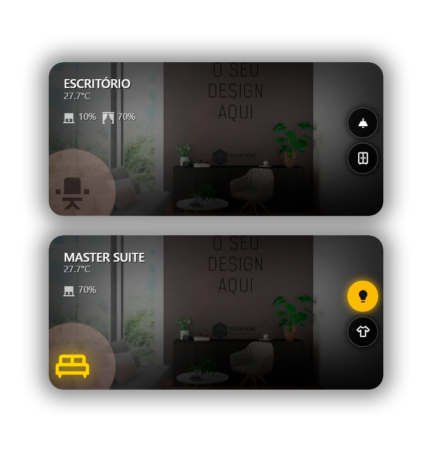
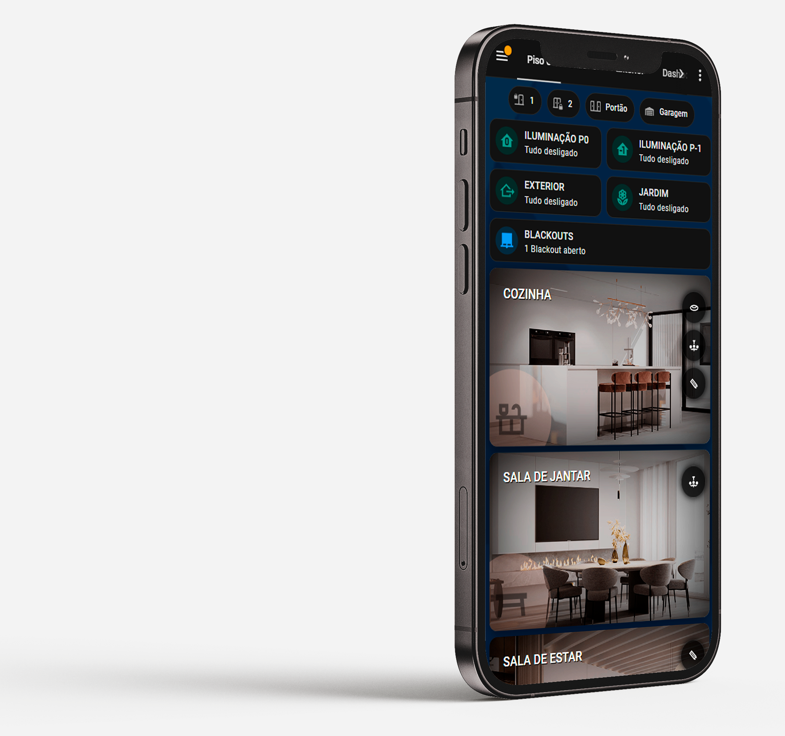

<p align="left">
  
</p>

# Tech@Home Room Card


Professional Room Card for Home Assistant.

Developed by **Tech@Home – Automação Residencial**.

The Tech@Home Room Card is a premium Lovelace card designed for professional Home Assistant installations. It combines a modern user interface with performance, reliability and long-term maintainability.

---

## Features

- Modern room interface
- Background image support
- Temperature display
- Quick control buttons
- Optional entities control panel
- Cover position indicators
- Room navigation
- Visual Lovelace editor
- Optimized for desktop, tablet and mobile devices

---

## Compatibility

| Component | Version |
|-----------|----------|
| Home Assistant | 2026+ |
| Browser | Chrome, Edge, Firefox |
| Mobile App | Android / iOS |


---

## Screenshots





---

## Installation

Copy the card to:

```text
/config/www/
```

Add the resource:

```text
/local/techathome-room-card.js
```

Restart Home Assistant or clear the browser/app cache if required.

---

## Basic Configuration

```yaml
type: custom:techathome-room-card
name: Living Room
icon: mdi:sofa
entity: switch.living_room
temperature_entity: sensor.living_room_temperature
background: /local/living-room.jpg
navigation_path: living-room

controls:
  - light.living_room
  - light.led_strip
  - switch.tv
  - input_boolean.scene_movie

covers:
  - entity: cover.blind
    type: persiana
```

`controls_type` is optional. When omitted, the card uses the original quick-button
mode with the same appearance and behaviour as v2.1.0.

### LAB entities mode

```yaml
type: custom:techathome-room-card
name: Corridors
icon: mdi:floor-plan
entity: light.corridors
temperature_entity: sensor.corridors_temperature
background: /local/corridors.jpg
navigation_path: corridors

controls_type: entities
controls:
  - light.table_lamp
  - light.entrance
  - switch.accent_light
  - input_boolean.night_mode
```

Entities mode embeds Home Assistant's native `entities` card with `state_color: true`,
`show_header_toggle: false`, and the compact styling used by the original manual
Tech@Home configuration. It displays up to four `light`, `switch`, or
`input_boolean` entries. The compact appearance requires `card-mod`, as did the
original manual configuration. Covers and all room-card gestures remain available.

---

## Repository Structure

```
techathome-room-card/

docs/
examples/
screenshots/
src/

README.md
```

---

## Documentation

| File | Description |
|------|-------------|
| docs/ARCHITECTURE.md | Internal architecture and design decisions |
| docs/CHANGELOG.md | Version history |

---

## Current Version

**v2.2.0-lab.4 Pre-release / LAB**

---

## Roadmap

- Performance improvements
- Internal refactoring
- Future feature expansion

---

Developed by **Tech@Home – Automação Residencial**


## License

Private repository.

Copyright © Tech@Home – Automação Residencial.
